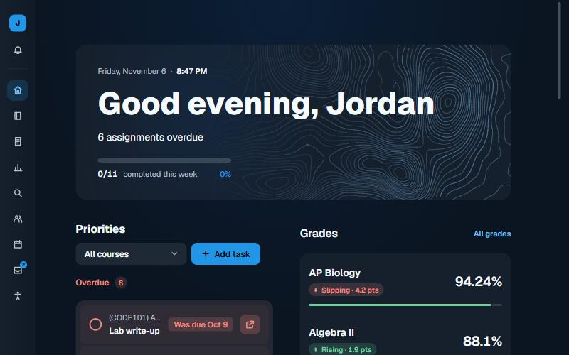
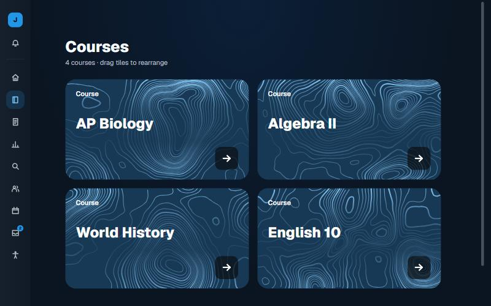
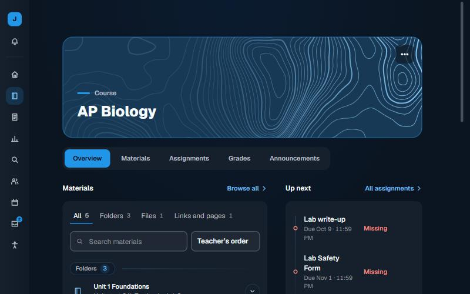
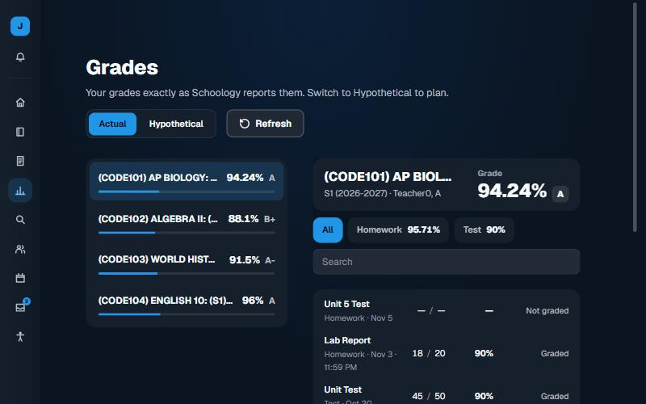
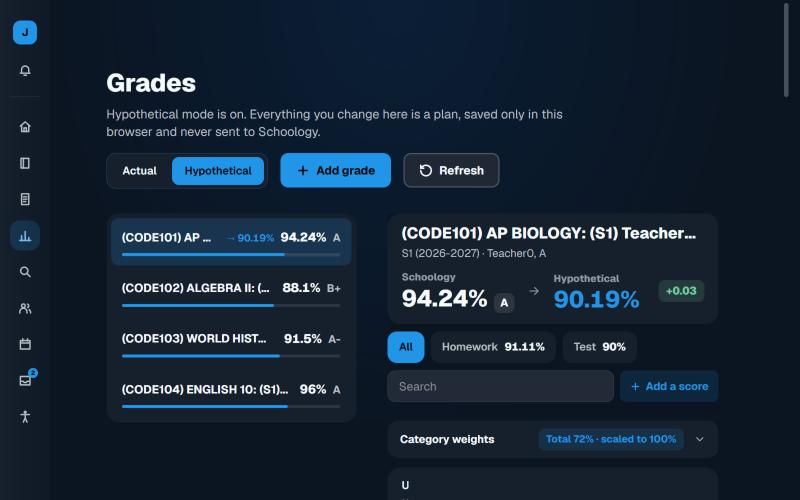
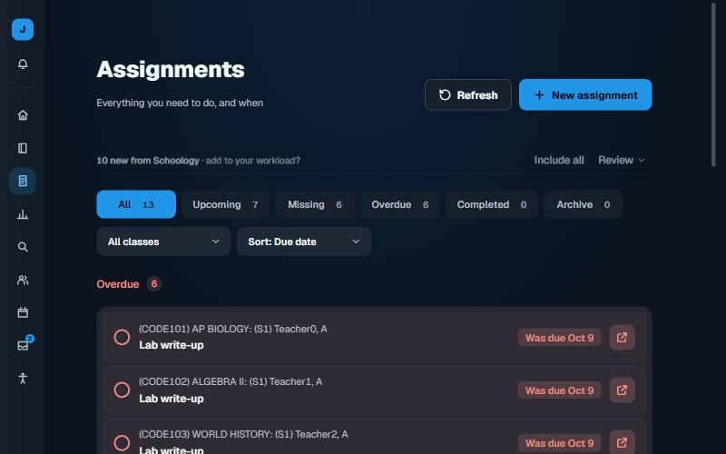
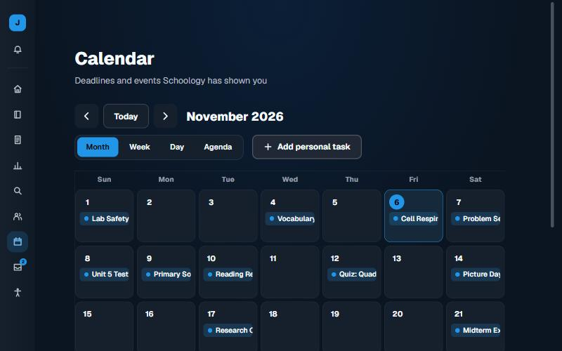

<p align="center"></p>

<h1 align="center">Schoology Overhaul</h1>

<p align="center">A calmer, faster, better-looking Schoology. Runs entirely in your browser.</p>

A Chrome extension that redesigns Schoology: a dashboard that says what is due, course pages, an assignment list, a gradebook with a hypothetical mode, a calendar, messages and search.

It only changes how Schoology **looks** in your browser. It reads pages you can already see, using your own session. Nothing is sent to any server, and it can be switched back to the classic view in one click.

<p align="center">
  
</p>

> The screenshots use made-up demo data from the local test server (see [Development](#development)) in the same blue as the logo. They are not from a real student account.

## Features

| | |
|---|---|
| **Dashboard** | A greeting, this week's progress, your priorities grouped as overdue, today, next 7 days and later, a grades panel, and recent announcements. Tick things off as you go, with Undo. |
| **Courses** | One tile per course, each in its own colour with its own topographic map. Click anywhere on a tile to open it, and drag tiles to reorder. |
| **Course pages** | Overview, Materials, Assignments, Grades and Announcements in one place, with folders, files and links read from Schoology. |
| **Assignments** | Filters (all, upcoming, missing, overdue, completed), sort by due date, class or status. Work you ticked off more than a week ago moves to an **Archive**, grouped by month and shown a page at a time, so long histories stay manageable. |
| **Grades** | Every course at a glance, newest assignment first, with a **Hypothetical** mode for planning. |
| **Calendar** | Month, week, day and agenda views, plus personal tasks that stay in your browser. |
| **Messages and Groups** | Read and send messages and browse your groups without leaving the new design. |
| **Search** | Press `/` or `Ctrl+K` to find assignments and courses. |
| **Updates** | A bell that opens beside the sidebar with your four most recent grades. Each grade is shown as a large percentage, with the points under it. |
| **Settings pages** | Schoology's own pages, such as your account, keep the same sidebar so you can always get back. |

<p align="center">
  
  
</p>

### Grades and Hypothetical mode

The Grades page lists your courses on the left and one course on the right. **Actual** shows the gradebook exactly as Schoology reports it.

**Hypothetical** turns the same page into a sandbox. Change any score, add scores of your own, and change category weights. The banner shows your Schoology grade next to the hypothetical one, and how far apart they are. A "Reset my changes" button puts everything back. Your real grades are never changed, and nothing is sent anywhere.

<p align="center">
  
  
</p>

<p align="center">
  
  
</p>

## Install

The extension is not on the Chrome Web Store yet, so you load it from this folder.

1. Download or clone this repository.
2. Open `chrome://extensions` and turn on **Developer mode**.
3. Choose **Load unpacked** and select the project folder.
4. Sign in to Schoology as usual and open your home page.

It works on addresses that match `*://*.schoology.com/*`. If your school uses its own domain, add it to both `matches` lists in `manifest.json`, then reload the extension.

To go back to the original Schoology at any time, choose **Classic view** in the account menu (the profile button at the top of the sidebar).

## Customising

Open **Settings** (the last icon in the sidebar).

- **Display:** a light, dark or system mode, and **Comfortable** or **Compact** density, which changes spacing on every page.
- **Accessibility:** text size (Default, Large, Larger), high contrast and reduce motion. The app also follows your system reduced-motion setting. Larger text scales the page, not the sidebar, and settings rows keep their controls on the right.
- **Appearance:** ten themes, five light (Cloud, Sage, Lavender, Ocean, Sand) and five dark (Coal, Midnight, Forest, Aubergine, Graphite). The background contour map has its own controls: on or off, density, line weight, strength, solid or dashed lines, and a button for a new random map. The interface picks light or dark text from the background colour so contrast holds.
- **Courses:** a name and colour for each course.
- **Data & privacy:** refresh, clear cached data, or reset every setting.

## What it fetches

Everything comes from Schoology pages you can already open, using your own session: your courses, the upcoming, overdue and event lists, the announcements feed, the gradebook, and course materials. Messages and groups are read when you open them.

- Every page that shows work also loads your grades, because they decide whether something counts as submitted, graded or missing.
- **Refresh** buttons fetch every source at once, whatever page is open.
- Results are cached for a few minutes, so switching pages does not refetch.
- If a fetch fails or your session has ended, the dashboard says so instead of showing old data as current.

Each list is read from its first page. If something in Schoology is missing here, see [If something does not show up](#if-something-does-not-show-up).

## Privacy and safety

- **Permissions:** only `storage`. There is no background worker and no host permission beyond Schoology itself.
- **No data leaves your browser.** The only network requests are to Schoology, using your existing session. No analytics, no third parties, no accounts.
- **Passwords are never read or stored.**
- **Your settings stay local.** Preferences, hypothetical grades, personal tasks and a cache of what was read live in `chrome.storage.local`. **Settings → Data & privacy → Clear cached data** wipes the cache.
- **Schoology keeps running.** The original page is hidden, never removed. Submitting work still happens on Schoology's own pages, and "done" ticks are a personal checklist saved only in your browser.
- **Nothing is invented.** Grades are shown as Schoology reports them. Hypothetical numbers are labelled as such.
- **Content from Schoology is treated as untrusted.** Descriptions and messages are sanitised before they are shown: scripts, frames, forms, media and inline handlers are removed, and only web links are allowed. Links open with `noopener noreferrer`, images send no referrer, and the file reader only opens files hosted on Schoology.

## Development

There is no build step. It is plain JavaScript and CSS loaded straight from the manifest.

```bash
node tests/mock-server.js    # a fake Schoology on http://localhost:4173/home
node tests/grade-cases.js    # each *-cases.js file is a standalone test
```

Run every test:

```bash
for f in tests/*-cases.js; do node "$f"; done
```

`tests/security-cases.js` checks the URL guards, scans the source for risky patterns (`eval`, `document.write`, unreviewed `innerHTML`, hard-coded external addresses) and checks that the manifest asks for nothing beyond `storage` and Schoology.

```
manifest.json
icons/                               extension icons (16, 48, 128) and the 512px logo
docs/screenshots/                    images used in this README
fonts/                               bundled Geist and Inter, with their licences
src/
  color.js, topo.js, early.js        first paint: contrast helpers, contour-map generator, theme and accessibility classes
  core.js                            namespace, preferences store, DOM helper h(), icons, dates, grade maths, sanitiser, URL guards
  data.js                            every Schoology selector (SEL), parsers, same-origin fetches, cache
  social.js, views-social.js         messages and groups
  reader.js                          opens course files inside the app
  views.js                           the screens, as functions from state to DOM
  app.js                             shell, router, sidebar, menus, updates bell
  styles.css, theme.css, studio.css  base tokens and components
  dash.css, pages.css, motion.css    dashboard, page and motion layers (pages.css loads late and holds the newest overrides)
tests/                               test scripts and the mock server
```

### If something does not show up

Schoology's markup differs a little between schools and versions, and the parsers were written against the structure I could test. If a page loads empty:

1. Open **Settings → Diagnostics**. It lists each data source, how many items it found and which address it used.
2. Adjust the matching entry in the `SEL` block at the top of `src/data.js`.
3. Reload the extension at `chrome://extensions`.

Known limits: only the first page of each Schoology list is read, the calendar shows items Schoology exposes through its upcoming and overdue lists and ones cached from earlier visits, and assignment-level grades appear only if Schoology's grades page includes them. Use **Classic view** for anything the new design cannot show.

## The logo

A white S on a Schoology-style blue tile, with a check-mark badge for getting things done. The badge overlaps the S, with a ring of the tile colour cut around it so the two read as one mark.

## Credits

Fonts are bundled and used under the SIL Open Font License: Geist and Inter. See `fonts/LICENSES.txt`.

## Disclaimer

This is an unofficial, independent project. It is not made, endorsed or supported by Schoology or PowerSchool. "Schoology" is a trademark of its owner and is used here only to say what the extension works with.
